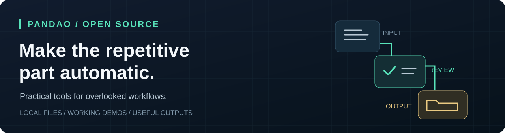

# Tianchao Daxing

**Creator of PANDAO. I build practical open-source tools for overlooked workflows.**

I turn repetitive handoffs and review work into tools you can run on your own files. My focus is on concrete tasks across industries: checking artwork before delivery, carrying approved captions into a new edit, organizing inspection photos, and recovering recording gaps.

**[Explore the tool collection →](https://tianchaodaxing-beep.github.io/pandao-open-tools/)** · **[Get in touch](mailto:tianchaodaxing@gmail.com)**

## Selected work

Each project below has a working browser demo, source code, and a downloadable release. Try the included example, then use your own files.

| Tool | What it helps you finish | Try it / get it |
| :--- | :--- | :--- |
| **[Artwork Code Audit](https://github.com/tianchaodaxing-beep/pandao-artwork-code-audit)** | Check packaging PDFs and images against approved product codes. Find swaps, missing codes, missing pages, and duplicate artwork; export an annotated review packet. | [Demo](https://tianchaodaxing-beep.github.io/pandao-artwork-code-audit/#demo) · [Download](https://github.com/tianchaodaxing-beep/pandao-artwork-code-audit/releases/latest) |
| **[Revision Inbox](https://github.com/tianchaodaxing-beep/pandao-revision-inbox)** | Match PDF revisions across folders by stable page IDs. Highlight changes and assemble a review packet. | [Demo](https://tianchaodaxing-beep.github.io/pandao-revision-inbox/#demo) · [Download](https://github.com/tianchaodaxing-beep/pandao-revision-inbox/releases/latest) |
| **[Caption Conform](https://github.com/tianchaodaxing-beep/pandao-caption-conform)** | Carry reviewed SRT captions into a revised video edit using old and new EDLs. Preserve wording and flag cut sentences or ambiguous mappings for review. | [Demo](https://tianchaodaxing-beep.github.io/pandao-caption-conform/#workbench) · [Download](https://github.com/tianchaodaxing-beep/pandao-caption-conform/releases/latest) |
| **[Route Photo Pack](https://github.com/tianchaodaxing-beep/pandao-route-photo-pack)** | Turn a route and geotagged inspection photos into station-named copies, a printable photo register, coverage intervals, and a review list. | [Demo](https://tianchaodaxing-beep.github.io/pandao-route-photo-pack/) · [Download](https://github.com/tianchaodaxing-beep/pandao-route-photo-pack/releases/latest) |
| **[Backup Audio Rescue](https://github.com/tianchaodaxing-beep/pandao-backup-audio-rescue)** | Recover digital-silence gaps from a backup WAV with timing and clock-drift alignment, listening review, and local exports. | [Demo](https://tianchaodaxing-beep.github.io/pandao-backup-audio-rescue/#demo) · [Download](https://github.com/tianchaodaxing-beep/pandao-backup-audio-rescue/releases/latest) |

## How I approach a tool

- **Start with a real task.** Define the input, the work to automate, and the file or packet someone needs at the end.
- **Keep files local.** The selected browser tools process files on your device, without an account or an API key.
- **Make review part of the result.** Ambiguous cases come with a review list instead of a silent guess.
- **Make it usable beyond the demo.** Provide downloads, examples, usage instructions, and checks for the supported workflow. Each repository documents its limits.

## Work with me

Interested in workflow integration, private deployment, or custom automation? Send the repetitive task, the input format, and the output your team needs. A redacted example is a useful starting point.

**Email:** [tianchaodaxing@gmail.com](mailto:tianchaodaxing@gmail.com)  
**Tools:** [PANDAO Open Tools](https://tianchaodaxing-beep.github.io/pandao-open-tools/)  
**Source collection:** [pandao-open-tools](https://github.com/tianchaodaxing-beep/pandao-open-tools)
